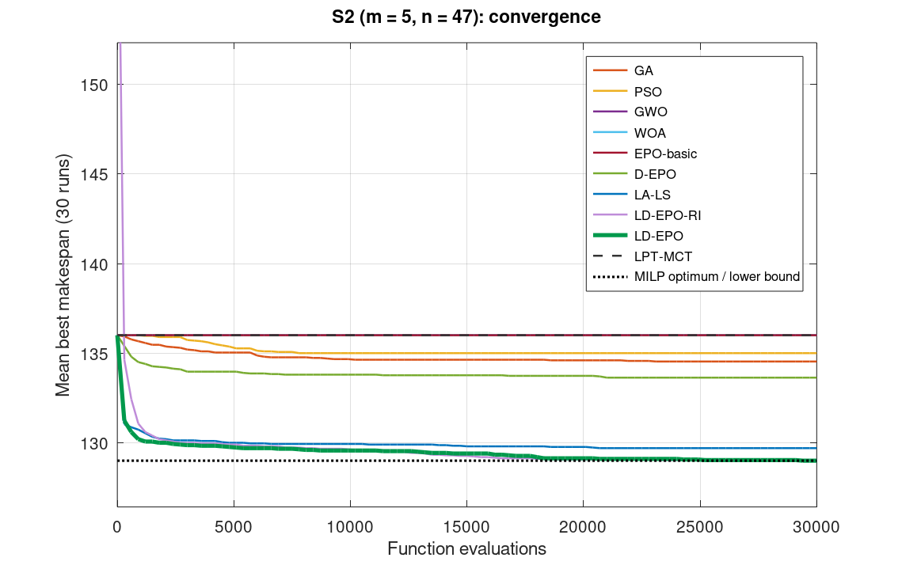
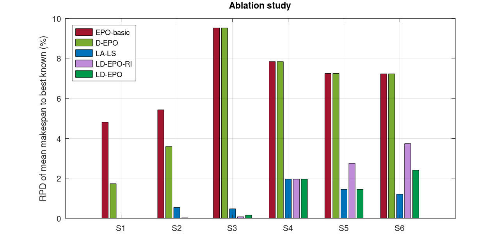

# LD-EPO: Discrete Load-Aware Emperor Penguin Optimizer for Block-to-Miner Assignment

MATLAB / GNU Octave implementation of **LD-EPO**, a discrete and load-aware version of the Emperor Penguin Optimizer (EPO) for assigning blocks to heterogeneous miners in a blockchain network. The objective is to minimise the makespan (the largest completion time among the miners).

The repository contains the algorithm, eleven comparison methods, an exact MILP model, the statistical tests, the test instances and the results reported in the paper.

## The problem

Each of the *n* blocks must be assigned to exactly one of the *m* miners. Block *i* takes `p_ij` time units on miner *j*. The goal is to minimise

```
Cmax = max_j  sum_i  x_ij * p_ij
```

This is the unrelated parallel machine scheduling problem `R||Cmax`, which is NP-hard.

## The method

A solution is an integer vector `X`, where `X(i)` is the miner of block *i*. LD-EPO keeps the logic of the original EPO and replaces its continuous update with discrete operators:

| EPO (continuous) | LD-EPO (discrete) |
|---|---|
| position `P` in R^n | assignment vector `X` in {1..m}^n |
| emperor `P_ep` | best solution `X_best` |
| `P_grid = abs(P - P_ep)` | normalised Hamming distance `G_i` to `X_best` |
| huddle temperature `T'` | `T'_t = 1 - FE_t / FE_max` |
| `A = M (T' + P_grid) rand - T'` | same formula with `G_i` |
| `P <- P_ep - A·D_ep` | `|A| >= 1`: **relocation** (exploration); `|A| < 1`: **huddle move** toward `X_best` (exploitation) |
| — | **load-aware move** with probability `p_LA` |
| — | non-worsening (greedy) acceptance |

The relocation and huddle moves never increase the makespan. The load-aware move (`algorithms/load_aware_move.m`) targets the bottleneck directly:

1. It selects the critical miner `j* = argmax_j T_j`.
2. It applies the best transfer of a block from `j*` to another miner.
3. If no transfer improves, it applies the best swap of a block on `j*` with a block on another miner.

The initial population contains the LPT-MCT solution, the Min-Min solution and random solutions.

## Repository layout

```
main.m                    runs everything (experiments, MILP, sensitivity, report)
config_experiment.m       all settings: scenarios, runs, budget, methods, parameters
algorithms/
  alg_ldepo.m             proposed LD-EPO (p_LA = 0 gives D-EPO)
  load_aware_move.m       load-aware transfer/swap operator
  relocate_genes.m        exploration operator
  huddle_move.m           exploitation operator
  init_population.m       shared initial population
  eval_pop.m              vectorised makespan evaluation
  alg_lals.m              LA-LS (load-aware local search, no EPO)
  alg_epo_continuous.m    original continuous EPO with rounding
  alg_ga.m, alg_pso.m, alg_gwo.m, alg_woa.m
  alg_greedy_mct.m, alg_greedy_minmin.m, alg_random_search.m
experiments/
  run_experiments.m       methods x scenarios x independent runs -> results/raw_S*.mat
  run_milp.m, solve_milp.m  exact MILP (intlinprog, or GLPK in Octave)
  run_sensitivity.m       one-factor-at-a-time sensitivity of LD-EPO
  make_report.m           tables (results/*.csv) and figures (figures/*.png)
  generate_instance.m     instance generator
  get_instance.m          reads instances/P_S*.csv (falls back to the generator)
stats/                    Wilcoxon rank-sum, Holm correction, Vargha-Delaney A12, Friedman / Iman-Davenport
plotting/                 Gantt chart and box plot helpers (no toolbox needed)
instances/                the six test instances (processing-time matrices)
results/                  results reported in the paper
figures/                  figures reported in the paper
tools/milp_highs.py       MILP with the open-source HiGHS solver (used for the paper)
```

## Requirements

- MATLAB R2016a or later, **or** GNU Octave 8 or later.
- No toolbox is required. `intlinprog` (Optimization Toolbox) is used for the MILP if available; otherwise GLPK is used. GLPK ships with Octave but is much slower.
- Optional: Python 3 with `highspy` and `numpy` for `tools/milp_highs.py`.

## Usage

```matlab
% quick smoke test (about 3 minutes; outputs go to results_quick/ and figures_quick/)
setenv('EPO_QUICK', '1'); main

% full reproduction (several hours)
setenv('EPO_QUICK', '0'); main
```

The scenarios are independent. To use several cores, run `run_experiments([1 2 3])` and `run_experiments([4 5 6])` in separate MATLAB sessions (after `addpath(genpath(pwd))` in the repository root), then `run_milp`, `run_sensitivity` and `make_report`.

To use LD-EPO on your own processing-time matrix `P` (n blocks × m miners):

```matlab
addpath(genpath(pwd));
prm = struct('N', 30, 'p_LA', 1, 'n_LA', 3, 'kappa', 2, 'M', 2);
res = alg_ldepo(P, prm, 30000);       % 30,000 objective evaluations
res.f        % makespan
res.x        % res.x(i) = miner of block i
```

Exact MILP with HiGHS:

```bash
pip install highspy numpy
python tools/milp_highs.py --all 600     # writes results/milp_results.csv
```

## Experimental setup

- **Instances:** `p_ij = max(1, round(s_i / v_j * e_ij))`, where:
  - `s_i` is the block workload, uniform on {5, …, 20}
  - `v_j` is the miner speed, uniform on [0.5, 2]
  - `e_ij` is a block–miner affinity factor, uniform on [0.9, 1.1]
- **Scenarios** (miners × blocks): S1 3×32, S2 5×47, S3 16×86, S4 32×200, S5 64×500, S6 100×1000. The instances are stored in `instances/`, so MATLAB and Octave use identical data.
- **Protocol:** 30 independent runs per method (seed = run index) and the same budget of 30,000 objective evaluations for every method.
- **Tuning:** algorithm parameters were tuned on separate instances (seeds 901–904), not on the test instances.
- **Statistics:** two-sided Wilcoxon rank-sum with Holm correction, Vargha–Delaney A12, and Friedman / Iman–Davenport.

## Main results

Mean makespan over 30 runs. The MILP column gives the optimum, or the best solution and the lower bound reached within 600 s.

| Scenario | MILP | LD-EPO | LA-LS | GA | LPT-MCT |
|---|---|---|---|---|---|
| S1 (3×32) | 104 (optimal) | **104.00** | 104.00 | 105.77 | 109 |
| S2 (5×47) | 129 (optimal) | **129.00** | 129.70 | 134.53 | 136 |
| S3 (16×86) | 42 (optimal) | 42.07 | 42.20 | 46.00 | 46 |
| S4 (32×200) | 51 (optimal) | **52.00** | 52.00 | 55.00 | 55 |
| S5 (64×500) | 69 (LB 68) | **70.00** | 70.00 | 74.00 | 74 |
| S6 (100×1000) | 83 (LB 82) | 85.00 | **84.00** | 89.00 | 89 |

- LD-EPO is significantly better than Random, LPT-MCT, Min-Min, GA, PSO, GWO, WOA, the original EPO and D-EPO in all six scenarios (Wilcoxon–Holm, α = 0.05).
- LD-EPO reached the MILP optimum in 88 of the 90 runs on S1–S3.
- The ablation study shows that most of the improvement comes from the load-aware operator. The load-aware local search without EPO (LA-LS) is statistically equal to LD-EPO in four scenarios, worse in S2 and better in S6.

The full tables are in `results/` (`table_main.csv`, `table_stats.csv`, `table_milp_gap.csv`, `table_friedman.csv`, `sensitivity_*.csv`).

<p align="center">
  
  
</p>

## Reproducibility notes

- The random number generators of MATLAB and Octave differ. A MATLAB run therefore gives slightly different numbers from the Octave results stored in `results/`; the instances themselves are identical in both.
- The results in `results/` were produced with GNU Octave 8.4 on Ubuntu 24.04 (Intel Xeon, 2 cores, 2.1 GHz, 8 GB RAM). The MILP results were produced with HiGHS 1.16.
- Running times are measured in Octave, which is interpreted, and are lower in MATLAB.

## Citation

If you use this code, please cite the paper (reference will be added after publication).

---

### توضیح فارسی

این مخزن کد کامل مقاله «الگوریتم گسسته و بارآگاه مبتنی بر بهینه‌سازی پنگوئن امپراطور برای تخصیص بلاک به ماینر در بلاکچین» است.

- **اجرا:** همه نتایج با اجرای `main` در MATLAB یا Octave بازتولید می‌شوند. برای آزمون سریع، پیش از اجرا دستور `setenv('EPO_QUICK','1')` را وارد کنید.
- **تنظیمات:** در فایل `config_experiment.m` هستند.
- **نمونه‌های آزمون:** در پوشه `instances` قرار دارند.
- **نتایج مقاله:** در پوشه‌های `results` و `figures` قرار دارند.
